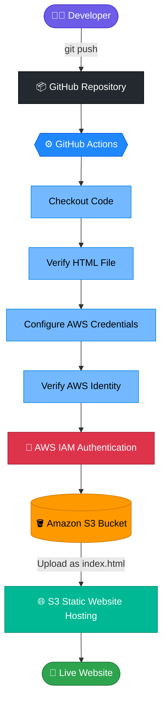

<!-- ===================== HEADER BANNER ===================== -->
<div align="center">


<a href="https://github.com/ajaydhadi95-gif/devops-roadmap">
  
</a>

<br/>


-8A2BE2?style=flat-square&logo=amazonaws&logoColor=white)


</div>


## 📑 Table of Contents

- [🌟 Project Overview](#-project-overview)
- [🏗️ Architecture](#️-architecture)
- [🧰 Technologies Used](#-technologies-used)
- [📂 Project Structure](#-project-structure)
- [☁️ AWS Configuration](#️-aws-configuration)
- [⚙️ GitHub Actions Pipeline](#️-github-actions-cicd-pipeline)
- [🔍 Pipeline Explanation](#-pipeline-explanation)
- [🌐 S3 Static Website Access](#-s3-static-website-access)
- [▶️ How to Execute](#️-how-to-execute-the-project)
- [✅ Expected Results](#-expected-pipeline-results)
- [🛠️ Troubleshooting](#️-troubleshooting)
- [🔐 Security Best Practices](#-security-best-practices)
- [🎓 Key Learning Outcomes](#-key-learning-outcomes)


## 🌟 Project Overview

This project demonstrates an **end-to-end CI/CD pipeline** using **GitHub Actions** and **AWS S3** to automatically deploy a static HTML website.

> 💡 Whenever a developer pushes code to the `main` branch, GitHub Actions triggers the pipeline, authenticates with AWS, and uploads the website to an S3 bucket — **no manual steps required**.

<div align="center">

| ⚡ Automated | 🔒 Secure | ☁️ Serverless | 🚀 Fast |
|:---:|:---:|:---:|:---:|
| Push → Deploy | GitHub Secrets + IAM | Static hosting on S3 | Live in seconds |

</div>

<!--
  🎬 DEMO GIF (optional but recommended)
  1. Record your pipeline run + live site with ScreenToGif / LICEcap / Kap
  2. Save it as  assets/pipeline-demo.gif  in this repo
  3. Uncomment the block below
-->
<!--
<div align="center">
  
  <br/><sub>Live pipeline run: push → build → deploy</sub>
</div>
-->

## 🏗️ Architecture



## 🧰 Technologies Used

<div align="center">


</div>

## 📂 Project Structure

```text
devops-roadmap/
│
├── 📁 .github/
│   └── 📁 workflows/
│       └── 📄 deploy.yml
│
├── 🌐 DevOps Roadmap (1).html
│
└── 📘 README.md
```

## ☁️ AWS Configuration

### 1️⃣ Create S3 Bucket

| ⚙️ Configuration | 📌 Value |
|---|---|
| Bucket Name | `github-actions-html-deploy-2026` |
| AWS Region | `ap-south-1` (Mumbai) |
| Hosting Type | Static Website Hosting |
| Index Document | `index.html` |

### 2️⃣ Enable Static Website Hosting

1. Open **AWS Management Console**
2. Navigate to **Amazon S3**
3. Select your bucket
4. Open **Properties**
5. Find **Static Website Hosting**
6. Click **Edit**
7. Enable **Static Website Hosting**
8. Select **Host a static website**
9. Set Index Document to `index.html`
10. **Save changes**

### 3️⃣ Configure IAM Permissions

Create an IAM user, or use an appropriately authorized IAM identity, for deployment.

| 🔑 Permission | 📝 Purpose |
|---|---|
| `s3:ListBucket` | List bucket contents |
| `s3:PutObject` | Upload the HTML file |
| `s3:DeleteObject` | Remove / overwrite objects |
| `sts:GetCallerIdentity` | Verify AWS identity in the pipeline |

> 🛡️ Restrict IAM permissions to the deployment bucket wherever possible.

### 4️⃣ Configure GitHub Secrets

Navigate to: **GitHub Repository → Settings → Secrets and variables → Actions → New repository secret**

| 🔐 Secret Name | 📝 Description |
|---|---|
| `AWS_ACCESS_KEY_ID` | AWS Access Key ID |
| `AWS_SECRET_ACCESS_KEY` | AWS Secret Access Key |

> ⚠️ **Never** store AWS credentials directly inside source code or workflow files.

## ⚙️ GitHub Actions CI/CD Pipeline

Create the workflow file: `.github/workflows/deploy.yml`

```yaml
name: HTML Website S3 Deployment

on:
  push:
    branches:
      - main

  workflow_dispatch:

jobs:
  deploy:
    name: Deploy HTML to AWS S3
    runs-on: ubuntu-latest

    steps:
      # Checkout GitHub Repository
      - name: Checkout Code
        uses: actions/checkout@v4

      # Verify HTML File
      - name: Verify Project Files
        run: |
          set -e
          test -f "DevOps Roadmap (1).html"
          echo "HTML file found successfully"

      # Configure AWS Credentials
      - name: Configure AWS Credentials
        uses: aws-actions/configure-aws-credentials@v4
        with:
          aws-access-key-id: ${{ secrets.AWS_ACCESS_KEY_ID }}
          aws-secret-access-key: ${{ secrets.AWS_SECRET_ACCESS_KEY }}
          aws-region: ap-south-1

      # Verify AWS Identity
      - name: Verify AWS Access
        run: |
          aws sts get-caller-identity

      # Deploy Website to S3
      - name: Deploy Website to S3
        run: |
          aws s3 cp "DevOps Roadmap (1).html" \
            s3://github-actions-html-deploy-2026/index.html \
            --content-type "text/html"

      # Deployment Status
      - name: Deployment Successful
        run: |
          echo "Website deployed successfully!"
```

## 🔍 Pipeline Explanation

<details>
<summary><b>🟦 Stage 1 — Checkout Code</b></summary>

```yaml
- name: Checkout Code
  uses: actions/checkout@v4
```

Downloads the source code from the GitHub repository into the GitHub Actions runner.
</details>

<details>
<summary><b>🟩 Stage 2 — Verify Project Files</b></summary>

```bash
test -f "DevOps Roadmap (1).html"
```

Checks whether the HTML file exists before deployment. If the file is missing, the pipeline **stops**.
</details>

<details>
<summary><b>🟧 Stage 3 — Configure AWS Credentials</b></summary>

```yaml
- name: Configure AWS Credentials
```

Uses GitHub Secrets to authenticate with AWS. The Access Key and Secret Access Key are securely provided to the workflow.
</details>

<details>
<summary><b>🟪 Stage 4 — Verify AWS Access</b></summary>

```bash
aws sts get-caller-identity
```

Verifies that GitHub Actions can successfully authenticate with AWS.
</details>

<details>
<summary><b>🟥 Stage 5 — Deploy Website to S3</b></summary>

```bash
aws s3 cp "DevOps Roadmap (1).html" \
s3://github-actions-html-deploy-2026/index.html \
--content-type "text/html"
```

Uploads the HTML file to the S3 bucket and saves it as `index.html`.
</details>

<details>
<summary><b>✅ Stage 6 — Deployment Successful</b></summary>

Displays a success message after the deployment command completes successfully.
</details>

## 🌐 S3 Static Website Access

After enabling Static Website Hosting, AWS provides a website endpoint.

**Find it here:** `S3 → Bucket → Properties → Static Website Hosting → Bucket Website Endpoint`

The website can be accessed through this endpoint once the required public-read access configuration is in place.

### 🔁 Workflow Trigger

| Trigger | Description |
|---|---|
| 🟢 `push` to `main` | Pipeline runs automatically |
| 🔵 `workflow_dispatch` | Manual execution from the Actions tab |

## ▶️ How to Execute the Project

```bash
# Step 1: Clone the repository
git clone https://github.com/ajaydhadi95-gif/devops-roadmap.git

# Step 2: Enter the project directory
cd devops-roadmap

# Step 3: Edit the HTML file  →  DevOps Roadmap (1).html

# Step 4: Commit your changes
git add .
git commit -m "Update HTML website"

# Step 5: Push to GitHub (triggers the pipeline 🚀)
git push origin main
```

**Step 6 — Verify the pipeline:**

1. Open the GitHub repository
2. Navigate to **Actions**
3. Select **HTML Website S3 Deployment**
4. Check the workflow execution logs
5. Verify that all deployment stages are successful

## ✅ Expected Pipeline Results

| 🔢 Pipeline Stage | 📊 Expected Status |
|---|:---:|
| Checkout Code | ✅ Success |
| Verify Project Files | ✅ Success |
| Configure AWS Credentials | ✅ Success |
| Verify AWS Access | ✅ Success |
| Deploy Website to S3 | ✅ Success |
| Deployment Successful | ✅ Success |

## 🛠️ Troubleshooting

<details>
<summary><b>❌ 1. HTML File Not Found</b></summary>

**Error**
```text
Error: Process completed with exit code 1.
```
**Solution:** Verify the correct HTML filename and repository path.
</details>

<details>
<summary><b>🔑 2. AWS Authentication Failed</b></summary>

**Error**
```text
Unable to locate credentials
```
**Solution:**
- Verify GitHub Secrets
- Check AWS Access Key ID
- Check AWS Secret Access Key
- Verify IAM permissions
</details>

<details>
<summary><b>🚫 3. S3 Access Denied</b></summary>

**Error**
```text
AccessDenied
```
**Solution:** Check IAM permissions and S3 bucket access configuration.
</details>

<details>
<summary><b>📜 4. S3 Bucket Policy Cannot Be Saved</b></summary>

**Check:**
- IAM `s3:PutBucketPolicy` permission
- Account-level Block Public Access settings
- Bucket-level Block Public Access settings
- AWS Organizations restrictions, if applicable
</details>

<details>
<summary><b>🔒 5. Website Shows 403 Forbidden</b></summary>

**Check:**
- Static Website Hosting is enabled
- `index.html` exists in the bucket root
- Bucket policy allows `s3:GetObject`
- Required public access settings permit the policy
- The correct S3 **website endpoint** is being used
</details>

## 🔐 Security Best Practices

- 🔑 Store AWS credentials in **GitHub Secrets**
- 🚫 Never commit AWS credentials to GitHub
- 🛡️ Apply **least-privilege** IAM permissions
- 🪪 Prefer **GitHub OIDC** over long-lived access keys for production
- 🙈 Avoid public access to private or sensitive S3 files
- 🌍 For production, use **CloudFront + private S3 + Origin Access Control**
- 📊 Enable versioning and appropriate monitoring where required

> [!WARNING]
> Public bucket access in this learning project is only for demonstrating S3 static website hosting. **Do not use this configuration for sensitive or production data.**

## 🎓 Key Learning Outcomes

After completing this project, you will understand:

1. ⚙️ How GitHub Actions works
2. 📝 How to create CI/CD pipelines using YAML
3. 🔗 How GitHub connects with AWS
4. 🔐 How AWS IAM authentication works
5. 🗝️ How to manage GitHub Secrets
6. 🪣 How to deploy static websites to Amazon S3
7. 🌐 How to configure S3 Static Website Hosting
8. 🧯 How to troubleshoot deployment failures and S3 Access Denied errors


## 🏁 Project Conclusion

Successfully implemented an automated CI/CD pipeline using **GitHub Actions** to deploy an HTML website to **Amazon S3**. The deployment is triggered automatically whenever new code is pushed to the `main` branch.

<div align="center">


<br/>

[](https://github.com/ajaydhadi95-gif/devops-roadmap)

<br/>

⭐ **If you found this project helpful, give it a star!** ⭐


</div>